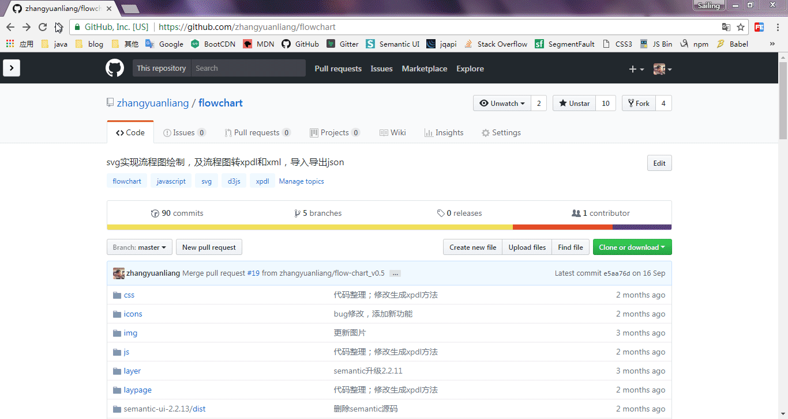
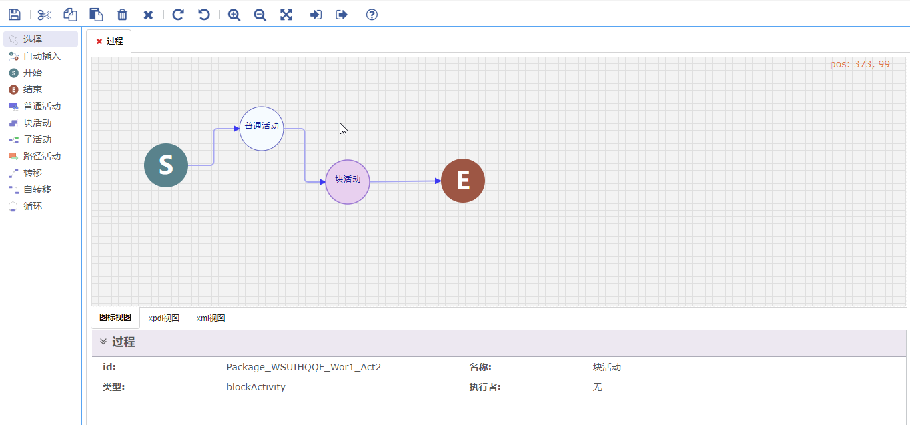
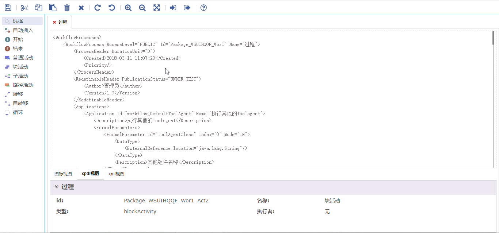
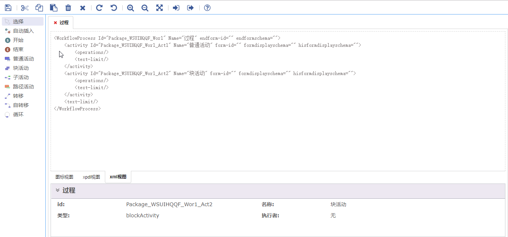

# SBPE — Flowchart Editor

> English translation of [zhangyuanliang/flowchart](https://github.com/zhangyuanliang/flowchart) (MIT License, © zhangyuanliang).
> All UI text, comments, and config labels have been translated from Chinese to English.

Original demo (Chrome, Chinese UI):
> &mdash;[**Demo Online**](https://zhangyuanliang.github.io/flowchart/flowchart.html)

SVG-based flowchart drawing. Front-end stack: `jquery.js` / `d3.js` / `semantic.css`

Features:
- Create, drag and connect flowchart blocks
- Zoom in/out
- Import/export `json` data
- Generates the corresponding `xml` and `xpdl`
- **Open existing XPDL files** (toolbar folder icon, or drag a file onto the canvas)
- Save (not finished yet, to be updated)

## Opening XPDL files

Click the **folder icon** in the toolbar (or drop a `.xpdl` / `.xml` file onto the canvas). The importer
(`js/xpdlImport.js`) reads XPDL from any tool:

- **Versions:** XPDL 1.0, 2.0, 2.1 and 2.2 (plus older drafts), with or without namespace prefixes, and
  bare `<WorkflowProcesses>` fragments
- **Encodings:** UTF-8, UTF-16, Windows-1252/Latin-1 and anything declared in the XML header
- **Layouts:** XPDL 2.x `NodeGraphicsInfo` (absolute or lane-relative, horizontal or vertical pools),
  JaWE/TWE lane offsets, and this editor's own format. Files with no layout are arranged automatically
- **Colors:** fill/border colors of activities and events, and line colors of transitions, in every format
  tools use (`220,220,220`, `220;220;220`, .NET ARGB integers like `-16553830`, `#RRGGBB`, `#AARRGGBB`,
  color names). They're kept when you save.
- **Content:** activities, routes/gateways, sub-flows, block activities/embedded sub-processes (open them
  with right-click → Edit), BPMN start/end events, transitions and conditions, participants, deadlines,
  and extended attributes (unknown ones are kept, so they're written back out on export)

If a file contains several processes (e.g. one per pool), you pick which one to open. Things the editor
can't show (message flows between pools, annotations) are skipped, and a summary tells you what was left out.

Tested against 200+ real XPDL files from Bizagi, Enhydra JaWE/TWE, Joget, TIBCO, Bonita, OFBiz/Shark,
BPSim, CMDBuild and others: every process imports, and exporting then re-importing gives the same diagram.

## Running locally

The page loads `wfConf/WfDSystemConfig.xml` via XHR, so serve it over HTTP rather than opening the file directly:

```sh
python3 -m http.server 8000
# then open http://localhost:8000/flowchart.html
```

### Screenshots

#### Main View

#### Xpdl View

#### Xml View


This project supports `Chrome/Firefox/IE11`; `Chrome` is recommended for testing.
